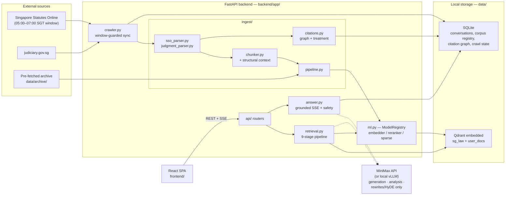
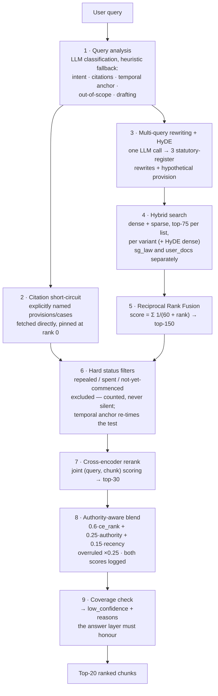

# SingLaw — technical architecture

> The full technical reference. For a short overview and quick start see the [top-level README](../README.md).

An offline-capable, locally-hosted Retrieval-Augmented Generation (RAG) assistant
that helps private citizens and small businesses find and understand the
Singapore law that applies to them. It ingests legislation from Singapore
Statutes Online (SSO) and judgments from judiciary.gov.sg, indexes them with
structure-aware chunking and hybrid dense+sparse retrieval, and generates
strictly grounded answers in which every proposition carries a citation to a
retrieved provision or judgment.

The design is **accuracy-first**: a fluent wrong answer about the law is worse
than no answer, so every layer — parsing, chunking, retrieval, ranking,
generation — is built around grounding, authority, temporal validity, and
visible uncertainty.

> **This assistant provides legal information, not legal advice.** It explains
> what the law says; it cannot tell you what to do in your specific situation.
> For advice on your own matter, consult a lawyer.

> **Attribution.** Legislation reproduced from SSO is © Singapore Government
> and reproduced with the permission of the Attorney-General's Chambers under
> the Singapore Statutes Online terms of use. Material downloaded from SSO is
> **not** an authoritative text — section 48 of the Interpretation Act 1965
> does not apply to it; the Gazette remains the authoritative text. The app
> surfaces this notice on every answer and every provision view
> (`AGC_ATTRIBUTION` in `backend/app/schemas.py`).

---

## Contents

1. [Overview & architecture](#1-overview--architecture)
2. [Data acquisition — the SSO crawler](#2-data-acquisition--the-sso-crawler)
3. [Parsing & cleaning](#3-parsing--cleaning)
4. [Chunking](#4-chunking)
5. [Contextual retrieval](#5-contextual-retrieval)
6. [Embeddings & model selection](#6-embeddings--model-selection)
7. [Sparse retrieval — BM25 term impacts](#7-sparse-retrieval--bm25-term-impacts)
8. [Vector store — embedded Qdrant](#8-vector-store--embedded-qdrant)
9. [The retrieval pipeline](#9-the-retrieval-pipeline)
10. [Citation graph & treatment](#10-citation-graph--treatment)
11. [Answer generation](#11-answer-generation)
12. [Storage — SQLite](#12-storage--sqlite)
13. [API reference](#13-api-reference)
14. [Frontend](#14-frontend)
15. [Evaluation](#15-evaluation)
16. [Setup & operations](#16-setup--operations)
17. [Design decisions & limitations](#17-design-decisions--limitations)

---

## 1. Overview & architecture

Everything except LLM text generation runs locally, in-process: embedding,
sparse encoding, reranking, vector search, and storage make no network calls.
The only remote dependency is an OpenAI-compatible chat-completions endpoint
(MiniMax by default) used for four things — query analysis, query
rewriting/HyDE, answer generation, and user-document context — and each of
those degrades gracefully when no API key is configured. Point `LLM_BASE_URL`
at a local vLLM server and the system is fully offline.

| Layer | Technology | Where |
|---|---|---|
| API | FastAPI (Python 3.12, async), SSE streaming | `backend/app/` |
| Vector DB | Qdrant **embedded** (`AsyncQdrantClient(path=...)`), no Docker/server | `backend/app/vectorstore.py` |
| Dense embeddings | `sentence-transformers`, default `Qwen/Qwen3-Embedding-0.6B` (local, in-process) | `backend/app/ml.py` |
| Sparse vectors | BM25 term impacts (bm25s tokenization, hashed vocab, Qdrant `Modifier.IDF`) | `backend/app/ml.py` |
| Reranker | Local cross-encoder, default `jinaai/jina-reranker-v2-base-multilingual` | `backend/app/ml.py` |
| LLM | MiniMax via OpenAI-compatible provider interface; local vLLM is a base-URL swap | `backend/app/llm.py` |
| Relational storage | SQLite (WAL, flock-elected single writer) | `backend/app/db.py` |
| Frontend | React 19 + TypeScript + Vite SPA — TanStack Router/Query, shadcn/ui, Tailwind v4, streamdown | `frontend/` |



Two Qdrant collections enforce a **trust boundary**: `sg_law` holds
authoritative material (legislation, judgments, practice directions);
`user_docs` holds the user's own uploads, which are treated as the user's
*factual situation* — never as legal authority. They are searched separately,
ranked differently, and the generation prompt explicitly forbids citing user
documents as law (see [§9](#9-the-retrieval-pipeline) and
[§11](#11-answer-generation)).

---

## 2. Data acquisition — the SSO crawler

`backend/app/crawler.py`

SSO's terms of use permit automated extraction **only between 05:00 and 07:00
Singapore Time**. The crawler treats this as a legal constraint, not a
politeness setting:

- **Guard before every fetch.** `CrawlWindow.is_open()` is checked before each
  individual HTTP request inside the sync loop, and a hard deadline (the
  event-loop time of the 07:00 close, computed at start) is checked alongside
  it. Whichever trips first stops the run mid-queue.
- **No bypass flag.** There is deliberately no way to force a live crawl
  outside the window. The `force` flag on `POST /api/admin/sync` only bypasses
  the "a sync is already running" check — never the window.
- **Incremental, never a full re-crawl.** `SSOCrawler.discover()` parses SSO's
  *What's New* listing and enqueues only changed documents: anchors under
  `/Act/`, `/SL/`, `/Acts-Supp/` as legislation and `/judgments/` as
  judgments.
- **Resumable state in SQLite.** Discovered URLs go into the `crawl_state`
  table with a `pending`/`done`/`error` status plus ETag and error columns. An
  interrupted run (window close, crash) simply resumes from the pending queue
  the next morning — `python -m app.crawler schedule` sleeps until the window
  opens and syncs daily.
- **Single connection, polite pacing, backoff.** The `httpx` client is limited
  to one connection (`max_connections=1`), sends an honest User-Agent naming
  the tool and its window compliance, sleeps `CRAWL_DELAY_SECONDS` (default 2 s)
  between fetches, and doubles the delay up to `CRAWL_MAX_BACKOFF_SECONDS`
  (default 300 s) after any HTTP error.
- **Treatment pass after fetches.** When a run ingested anything, the
  citation-graph treatment pass ([§10](#10-citation-graph--treatment)) runs
  before the `last_sync` timestamp is recorded.

**Seeding without crawling.** `python -m app.crawler seed --archive <dir>`
(`make seed`) loads any pre-fetched archive laid out as `manifest.json` plus
HTML files — the path used for offline distribution and for the bundled dev
fixture corpus in `data/archive/`. Seeding is not fetch traffic, so it is not
window-restricted.

CLI summary:

```bash
python -m app.crawler seed --archive ../data/archive   # load archive, no crawling
python -m app.crawler sync                             # one window-guarded incremental run
python -m app.crawler schedule                         # sleep until 05:00 SGT, sync, repeat
```

---

## 3. Parsing & cleaning

### 3.1 Legislation — `backend/app/ingest/sso_parser.py`

Legislation is not flowing prose; it is a tree —
**Act → Part → Division → Section → Subsection → Paragraph → Sub-paragraph** —
and its position in that tree *is* its legal meaning and its citation
(`s 14(2)(a)`). The parser therefore rebuilds the tree rather than treating
the page as text:

1. **Linearization.** HTML is flattened into `(css_classes, text)` lines, one
   per leaf block, with inline markup joined so `<strong>14.</strong>—(1) …`
   stays a single line. Text is normalized on the way (non-breaking spaces,
   en-dash → em-dash, curly quotes → straight) so the provision-number regexes
   see canonical input.
2. **Metadata extraction** from tolerant patterns over the whole page: title
   (`actHd`/`legis-title`/`h1`/`<title>` fallback chain), long title (`An
   Act…` / `An Order…`), `Current version as at <date>` → `sso_version_date`,
   `Date of commencement: <date>` → `in_force_from`, and **repeal detection** —
   `Repealed by Act N of YYYY [with effect from <date>]` sets
   `status="repealed"`, `repealed_by`, and `in_force_to`; a bare `REPEALED`
   marker also flips the status.
3. **A state machine over the lines** builds the tree: `PART …` (or the
   `partNo` class) opens a Part whose next line is its heading; `Division N —
   Heading` opens a Division; `14.—(1) text` opens a section with its first
   subsection; `(2)` / `(a)` / `(i)` attach as subsection, paragraph, or
   sub-paragraph, with a stack keeping attachment legal (a sub-paragraph may
   only hang off a paragraph, and so on).

**Pattern-based tolerance to markup drift.** SSO's CSS classes (`prov1Hdr`,
`partNo`, `actHd`, …) are used only as *hints*; every structural decision has
a text-pattern fallback (`^PART \w+$`, `^(\d+[A-Z]{0,2})\.\s`, `^\(…\)`,
heading-shape heuristics). If SSO renames classes, parsing degrades to plain
mode rather than breaking. One notable disambiguation: `(i)` after paragraph
`(h)` is the *ninth letter paragraph*, not a roman sub-paragraph — resolved by
checking whether the token is the alphabetic successor of the currently open
paragraph.

**Unparsed residue is logged, never dropped silently.** Any line the state
machine cannot attach lands in `LegisDoc.unparsed`, and
`ingest_legislation_html` (`backend/app/ingest/pipeline.py`) logs a warning
with the residue count and its first line. That makes markup drift visible in
the logs of the first real crawl instead of quietly corrupting the corpus.

*Why not a generic text splitter?* A fixed-window splitter would cut
mid-provision, orphan subsection `(2)` from the section that gives it meaning,
and destroy the 1:1 mapping between chunks and citable units — which the whole
citation-grounding protocol ([§11](#11-answer-generation)) depends on.

### 3.2 Judgments — `backend/app/ingest/judgment_parser.py`

Judgments are segmented on their **`[n]` paragraph numbers**, because the
paragraph is the citation unit in Singapore practice (`[2022] SGCA 60 at
[41]`). The parser:

- extracts the **neutral citation** and court code (`[2022] SGCA 60`), the
  **case name**, **coram** (judge list, split on commas/`and`), **decision
  date** (`Decision Date: …`), **catchwords** (`Judg-Catchwords` classes), and
  the **disposition** (outcome language such as "appeal is dismissed",
  searched in the final three paragraphs);
- maps the court code to a human-readable court name, a `court_level`
  (SGCA=5 … SGDC/SGMC=1, used by the treatment pass), and a binding/non-binding
  tier (SGCA and SGHC(A) are `BINDING_COURTS` in `backend/app/schemas.py`);
- segments paragraphs with a **monotonicity check**: a line starting with a
  number opens a new paragraph only if the number plausibly continues the
  sequence (first paragraph ≤ 3; thereafter within +5 of the expected next
  number). Stray numbers inside body text therefore don't fork paragraphs;
  everything else is appended to the current paragraph. `Judg-*` header
  furniture before paragraph `[1]` is skipped.
- records every **outbound neutral citation** found in the body (minus the
  judgment's own) for the citation graph.

Here too, `Judg-*` class names are hints with pattern fallbacks (e.g. the
neutral citation is recovered from `<title>` or the full text if the citation
element is missing).

---

## 4. Chunking

`backend/app/ingest/chunker.py`

| Material | Unit | Oversize handling |
|---|---|---|
| Legislation | One chunk per **section** (the citation unit) | Split **only at subsection boundaries**, never mid-provision |
| Judgments | Groups of consecutive **`[n]` paragraphs** up to ~4,000 chars | New group at a paragraph boundary |
| Practice directions, user uploads | Paragraph-boundary generic chunking (`generic_chunks`) | New group at a paragraph boundary |

- A section that fits in `DEFAULT_MAX_CHARS` (4,000 characters) — or has no
  subsections — becomes one chunk with citation `Employment Act 1968, s 14`
  and chunk id `employment-act-1968:s14`.
- An oversized section is split into runs of whole subsections; each split
  chunk repeats the section's opening text as a header, is cited as
  `…, s 14(3)–(5)`, and lists its sibling subsections as related provisions in
  its context string so the retriever and the reader both know the chunk is
  partial.
- Judgment chunks are cited as `[2022] SGCA 60 at [12]–[19]` (or the bare
  neutral citation when the judgment fits in one chunk).
- Every chunk carries an `authority_tier`: 1 Constitution, 2 Act,
  3 subsidiary legislation, 4 binding judgment (SGCA / SGHC(A)), 5 other
  courts, 6 guidance/practice directions. User documents are outside the
  authority scale entirely.

---

## 5. Contextual retrieval

A chunk like "(2) The notice may be waived by either party." embeds poorly on
its own — nothing says which Act, which section, or whether the law is in
force. Following Anthropic's *contextual retrieval* pattern, every chunk gets
a short situating context **prepended before embedding** (dense and sparse
both encode `context + "\n\n" + text`, see `upsert_chunks` in
`backend/app/ingest/pipeline.py`).

**For the `sg_law` corpus the context is derived deterministically from the
parse tree** — no LLM involved (`_section_context` / `_judgment_context` in
`backend/app/ingest/chunker.py`):

> *This is section 14 of the Employment Act 1968 (Singapore), within Part II
> (Termination of Contract). The section is titled "Misconduct of employee".
> It is in force as at 2026-09-02. Related provisions: s 13, s 15.*

and for judgments:

> *This is paragraphs [12]–[19] of the judgment in ABC Pte Ltd v Tan [2022]
> SGCA 60 (Court of Appeal, decided 15 June 2022). Catchwords: Employment law
> — Wrongful dismissal.*

Why deterministic beats LLM-generated context *here*: the parse tree already
contains exactly the information an LLM would be asked to infer (identity,
hierarchy, status, neighbours), so generation would add cost, latency, and a
hallucination surface to thousands of chunks for zero information gain — and
the deterministic string is reproducible across reindexes. The status sentence
("It was repealed by … and is no longer in force…") also bakes temporal
validity into the embedded text itself.

**User uploads are the one exception.** They have no parse tree, so
`_user_chunk_context` (`backend/app/ingest/pipeline.py`) asks the LLM for a
one-to-two-sentence context per chunk, **cached by SHA-256 content hash** in
`data/cache/user_ctx/` so re-ingesting the same content never re-calls the
API. Without an LLM key it falls back to a deterministic template. Either way
the context appends a marker that the material is *"uploaded by the user;
factual background, not legal authority"* — the trust boundary again.

---

## 6. Embeddings & model selection

`backend/app/ml.py`, `backend/app/config.py`

### 6.1 Dense embedder

The default is **`Qwen/Qwen3-Embedding-0.6B`** via `sentence-transformers`,
producing 1024-dimensional normalized vectors, cosine distance. Reasons:

- **Local by requirement.** The spec forbids network calls for embedding, so
  API embedders are out. A 0.6 B-parameter model is the sweet spot that runs
  acceptably on a laptop CPU/MPS while being markedly stronger on retrieval
  than the classic MiniLM class of models.
- **Asymmetric encoding.** Qwen3-Embedding ships a built-in `"query"` prompt
  in its model config; `STEmbedder` detects and applies it to queries only
  (`encode_queries` vs `encode_docs`). Short lay questions and long statutory
  chunks get encoded into a space designed for that asymmetry.
- **Multilingual headroom** for Singapore-context queries mixing English with
  local terms.

Inference is in-process, loaded **once at startup** into a shared
`ModelRegistry` singleton and dispatched to a thread pool (never per-request
loads, never per-request network calls).

### 6.2 Model profiles

`MODEL_PROFILE` selects a coherent embedder+reranker pair
(`_PROFILES` in `backend/app/config.py`):

| Profile | Embedder | Reranker | Purpose |
|---|---|---|---|
| `full` (default) | `Qwen/Qwen3-Embedding-0.6B` | `jinaai/jina-reranker-v2-base-multilingual` | Real quality; the spec defaults |
| `dev` | `sentence-transformers/all-MiniLM-L6-v2` | `cross-encoder/ms-marco-MiniLM-L-6-v2` | Fast local iteration (~120 MB total) |
| `stub` | Deterministic hash embeddings | Lexical-overlap scorer | Zero downloads; the offline test suite |

`EMBEDDING_MODEL` / `RERANKER_MODEL` override either half independently.

**Reindex on model change.** Vectors from different embedders are
incompatible (different dimensions, different spaces). At startup
`ensure_collections` (`backend/app/vectorstore.py`) compares the stored dense
dimension against the configured embedder and **fails loudly** with
instructions (`make clean && make seed`) rather than letting a mismatch
explode at query time — a guard added after a stub-profile run silently
created 256-dim collections in a real data dir (DECISIONS.md #17).

### 6.3 Reranker

The default reranker is **`jinaai/jina-reranker-v2-base-multilingual`**, a
cross-encoder. The distinction matters:

- A **bi-encoder** (the embedder) encodes query and document *independently*;
  relevance is a vector distance. That's what makes million-chunk search
  feasible, but the two texts never attend to each other.
- A **cross-encoder** feeds the concatenated (query, chunk) pair through the
  model so every token attends to every other. It is far more accurate at
  judging actual relevance and far too slow to run over a corpus — so it runs
  only over the ~150 fused candidates per query (stage 7,
  [§9](#9-the-retrieval-pipeline)).

`RERANKER_MODEL=Qwen/Qwen3-Reranker-0.6B` swaps in Qwen's reranker, which is
not a classification cross-encoder but a **causal LM scored on its yes/no
logits**: `QwenReranker` builds the model's chat-format prompt around each
(query, document) pair, takes the final-position logits for the tokens `yes`
and `no`, and uses softmax-normalized P("yes") as the relevance score.

---

## 7. Sparse retrieval — BM25 term impacts

`SparseEncoder` in `backend/app/ml.py`

Dense embeddings are good at meaning but fuzzy about *exact terms* — and
statutory language turns on exact terms. A query for "s 45 notice" or
"Employment Claims Act 2016" must rank the chunk containing that literal
string above semantically-adjacent neighbours. Hybrid search therefore pairs
every dense search with a BM25 sparse search over the same text.

Implementation:

- **Tokenization** uses `bm25s.tokenize` (English stopword removal +
  stemming), the same treatment for documents and queries.
- **Stable hashed vocabulary.** Each token maps to a 32-bit id via a
  `blake2b` digest — no vocabulary store to maintain, persist, or keep in sync
  across processes; ids are stable across runs by construction.
- **Doc side stores the TF component only.** For each document token,
  the stored weight is BM25's term-frequency saturation term
  `tf·(k1+1) / (tf + k1·(1 − b + b·dl/avgdl))` with `k1=1.5`, `b=0.75`.
  `avgdl` is a rolling per-collection statistic (document count and total
  length persisted in `data/cache/bm25_stats.json`).
- **IDF is applied by Qdrant at query time.** The sparse index is configured
  with `Modifier.IDF` (`backend/app/vectorstore.py`), so Qdrant multiplies in
  inverse document frequency from *live* corpus statistics on every query.
  Query vectors are simply the set of distinct hashed query tokens with weight
  1.0. This is the key trick: IDF changes as the corpus grows, but because it
  lives on the query side, **old document vectors never need re-encoding** —
  the incremental crawler can keep adding documents forever and scoring stays
  corpus-consistent.

---

## 8. Vector store — embedded Qdrant

`backend/app/vectorstore.py`

Qdrant runs **embedded in the API process** — `AsyncQdrantClient(path=...)`
persisting to `data/qdrant/` on local disk. No Docker, no server, no ports;
consistent with the fully-local design. (The tradeoff: embedded Qdrant is
single-process — see [§16.6](#166-operational-notes).)

Two collections, one trust boundary:

| Collection | Contents | Trust |
|---|---|---|
| `sg_law` | Legislation, judgments, practice directions | Authority — ranked by tier, citable as law |
| `user_docs` | The user's uploads, namespaced by `user_id` | The user's *facts* — never authority, never blended into the law index |

Each point carries **named vectors**: `dense` (cosine, dimension from the
active embedder) and `sparse` (BM25 impacts with the IDF modifier). Point IDs
are UUIDv5 hashes of the chunk id, so re-ingesting a document overwrites its
chunks idempotently.

### 8.1 Chunk payload schema

Every point stores the full metadata payload (`ChunkPayload` in
`backend/app/schemas.py` — the spec §2.4 schema plus storage fields):

| Field | Meaning |
|---|---|
| `chunk_id` | Stable id, e.g. `employment-act-1968:s14`, `2022-sgca-60-…:para12-19` |
| `doc_id` | Parent document id (slugified title / citation) |
| `collection` | `sg_law` or `user_docs` |
| `user_id` | Owner — `user_docs` only (`local` in v1) |
| `text` | The chunk text (what gets quoted) |
| `context` | The contextual-retrieval prefix ([§5](#5-contextual-retrieval)) |
| `title` | Document title (Act name / case name / filename) |
| `doc_type` | `act`, `subsidiary_legislation`, `judgment`, `practice_direction`, `guidance`, `user_document` |
| `authority_tier` | 1 Constitution … 6 guidance ([§4](#4-chunking)) |
| `status` | `in_force`, `repealed`, `spent`, `not_yet_commenced`, `n_a` |
| `in_force_from` / `in_force_to` | Commencement / repeal-effective dates |
| `repealed_by` | Repealing instrument, e.g. `Act 21 of 2015` |
| `citation` | Canonical legal citation, e.g. `Employment Act 1968, s 14` |
| `hierarchy_path` | `[Act, Part, Division, Section]` breadcrumb (drives the explorer tree) |
| `court` / `court_level` | Judgments: court name and precedence level |
| `decision_date` | Judgment date |
| `cites` | Outbound neutral citations found in the judgment |
| `treatment` | `good`, `distinguished`, `overruled`, `unknown` — maintained by the treatment pass |
| `source_url` | SSO / judiciary URL (legislation chunks get a `#pr14-` provision anchor) |
| `sso_version_date` | "Current version as at" date of the fetched consolidation |

`qdrant_payload()` additionally mirrors the three date fields as integers
(`decision_date_int = 20220615` etc.) so date **range filters** work portably
in embedded mode without payload-type gymnastics.

### 8.2 Startup dimension guard

`ensure_collections(dim)` verifies on every startup that existing collections
match the active embedder's dimension and raises with a reindex instruction if
not ([§6.2](#62-model-profiles)).

---

## 9. The retrieval pipeline

`backend/app/retrieval.py` — nine stages, executed by `retrieve()`. The
pipeline works fully offline: with no LLM key, stage 1 falls back to regex
heuristics and stage 3 is skipped; everything else is local regardless.



**Stage 1 — query analysis** (`analyze_query`). One LLM call classifies
intent (`statutory_lookup` / `procedural` / `rights_obligations` / `case_law`
/ `out_of_scope`), canonicalizes any citations named in the query, detects a
temporal anchor ("what was the law in 2019?" → anchor 2019-12-31), an explicit
ask for repealed law, out-of-scope questions (other jurisdictions,
non-legal), and drafting requests. Regex heuristics (`analyze_heuristic`)
compute the same fields offline and always run first — the LLM augments rather
than replaces them, so a dead API never blinds the pipeline. The offline
foreign-jurisdiction check deliberately requires a named jurisdiction *near* a
legal term, so "my US employer's Singapore branch" doesn't trip it.

**Stage 2 — citation short-circuit** (`resolve_citations`). If the user named
a provision or case, semantic search must not be asked to *rediscover* it.
Named statutes are fetched by exact citation match from Qdrant payloads (with
a fallback scan over the document's chunks for split sections like
`s 14(1)–(2)`); neutral citations resolve through the SQLite judgments table
to the document's first chunks. These arrive **pinned**: they sort at rank 0,
survive every later truncation, and are exempt from status filters (asking
about a repealed section by name should show it — flagged, not hidden).

**Stage 3 — rewriting + HyDE** (`rewrite_and_hyde`, one combined LLM call).
Laypeople ask "can my boss fire me while I'm sick?"; the corpus says
"termination of contract during sick leave". Three rewrites re-express the
question in statutory register from different angles (statutory / rights-
duties / procedural-or-case-law). **HyDE** (Hypothetical Document Embedding)
goes further: the LLM writes a ~120-word passage *as if it were the provision
or judgment paragraph that answers the question* — formal legislative style,
with invented section numbers omitted rather than fabricated — and that
passage is embedded **with the document encoder** and searched. A fake answer
in the right register lands much closer to the true provision in embedding
space than the lay question does; this is the main bridge across the
lay-to-statutory vocabulary gap. Skipped silently when no LLM is configured.

**Stage 4 — parallel hybrid search** (`_hybrid_search`). For every query
variant (original + rewrites), a dense and a sparse search run concurrently
against `sg_law`, top-75 each, plus one dense search for the HyDE passage —
all via `asyncio.gather`. `user_docs` is searched separately (top-10,
filtered to the current `user_id` and optionally to the conversation's
selected documents, no HyDE), keeping the trust boundary intact.

**Stage 5 — Reciprocal Rank Fusion** (`rrf_fuse`). Dense cosine scores and
BM25 impact scores are incommensurable, so fusion uses ranks only:

```
RRF(chunk) = Σ over result lists  1 / (k + rank)     (k = 60, rank 1-based)
```

A chunk that appears mid-list in *many* lists beats one that tops a single
list — robust consensus without score calibration. Top-150 proceed.

**Stage 6 — hard status filters** (`apply_hard_filters`). Repealed, spent, and
not-yet-commenced law is *excluded* from evidence — a wrong-but-plausible
answer built on repealed law is the exact failure mode this system exists to
prevent. Three principles:

- **Counted, never silent.** Every exclusion increments a `FilteredCounts`
  bucket that flows through the API into the UI ("2 repealed provisions were
  excluded") — the user learns the law *changed*, which is itself legal
  information.
- **Temporal anchors re-time the test.** With an anchor (e.g. 2019), the
  filter keeps what was in force *then*: legislation commencing after the
  anchor or repealed before it is excluded; judgments decided after it are
  excluded.
- **Pinned citations and user documents are never dropped** — explicitly
  requested law is shown with warnings instead, and the user's facts are not
  subject to force-of-law tests. An explicit "tell me about the repealed X"
  (`include_repealed`) disables the filter entirely.

**Stage 7 — cross-encoder rerank.** Every surviving candidate is scored
jointly with the query ([§6.3](#63-reranker)) over `citation + context +
first 1,500 chars`; top-30 proceed (pinned first).

**Stage 8 — authority-aware final blend** (`authority_rank`). Relevance alone
must not rank a blog-tier source above the Act, or an overruled case above the
one that overruled it:

```
final = W_CROSS_ENCODER·ce_norm + W_AUTHORITY·authority + W_RECENCY·recency
        (defaults 0.6 / 0.25 / 0.15 — configurable via .env, logged per result)
```

- `ce_norm` is the **rank percentile** of the cross-encoder score, not a
  min-max or sigmoid normalization. Found the hard way (DECISIONS.md #16):
  min-max amplified tiny score gaps until an overruled case outranked the CA
  decision, and sigmoid saturates on logit-scale rerankers, flattening
  everything to ties. Rank percentile is scale-robust across reranker
  families.
- `authority` comes from a tier table: Constitution 1.0, Act 0.92,
  subsidiary legislation 0.8, binding judgment 0.75, other courts 0.55,
  guidance 0.35 — **multiplied by 0.25 if the citation graph marked the
  judgment `overruled`**.
- `recency`: judgments decay linearly to 0 over 25 years (0.5 when undated);
  in-force consolidated legislation is always 1.0 (the consolidation *is*
  current); non-in-force text scores 0.2.
- User-document chunks bypass the blend and rank on pure relevance —
  authority scoring the user's own facts would be a category error.
- Both raw and blended scores are kept on every result and logged, so the
  weights can be tuned against real queries.

**Stage 9 — coverage check** (`coverage_check`). Before anything is generated,
the pipeline asks whether the evidence actually supports an answer, and sets
`low_confidence` with machine-readable reasons: `no_results`,
`all_results_filtered`, `no_authoritative_sources` (only user docs matched),
`weak_relevance` (best absolute cross-encoder score of the top law chunks
below `LOW_CONFIDENCE_THRESHOLD` — the *absolute* sigmoid score, not the rank
percentile), `overruled_authority_in_top_results` (an overruled case in the
top 5 with no better authority ranked above it — when the overruling or other
binding authority already outranks it, the conflict is resolved and only the
per-source OVERRULED badge is shown), and `guidance_outranks_legislation`. The
answer layer is contractually required to honour the flag
([§11](#11-answer-generation)).

---

## 10. Citation graph & treatment

`backend/app/ingest/citations.py`, treatment pass in
`backend/app/ingest/pipeline.py`

Case law has a lifecycle: judgments get distinguished and overruled. Serving
an overruled holding as good law is a *correctness* failure, not a ranking
nuance — so the system maintains a citation graph and derives a conservative
per-judgment `treatment`.

**Extraction.** Two regex families run over every judgment paragraph at
ingest: neutral citations (`\[(\d{4})\]\s+(SG[A-Z]{2,6}(?:\([A-Z]\))?)\s+(\d{1,4})`
— `[2022] SGCA 60`, including bracketed court codes like `SGHC(A)`) and
statutory references (`s 14(2) of the Employment Act 1968` → canonicalized to
`Employment Act 1968, s 14(2)`; bare Act mentions yield the Act citation).
Each becomes a directed edge (citing judgment → cited authority) stored in
SQLite (`citation_edges`), with the paragraph number.

**Proximity-scoped treatment hints.** A hint is attached only when explicit
treatment language (`overruled`, `no longer good law`, `wrongly decided`,
`cannot stand` / `distinguish…`) appears within ±300 characters of the
citation *in the same paragraph*. Proximity, not paragraph mood: a paragraph
that overrules X while citing Y neutrally must not smear "overruled" onto Y.

**Conservative resolution** (`resolve_treatment` + `run_treatment_pass`). A
judgment is marked `overruled` only when **all three** hold:

1. the citing judgment is **later in time** (earlier or same-day citers are
   filtered out before resolution);
2. the citing court is **same-or-higher level** (a District Court cannot
   overrule the Court of Appeal — such a hint degrades);
3. the overruling language is **explicit** (the regex above; mere criticism
   does not count).

Anything ambiguous resolves to `distinguished`, `good`, or stays `unknown` —
false negatives are deliberately preferred over false "overruled"
(DECISIONS.md #9). The pass runs after every seed/sync, updates the
`judgments` table, and pushes the new `treatment` into every Qdrant chunk
payload of the affected judgment, where it feeds the ranking penalty
([§9](#9-the-retrieval-pipeline) stage 8), the coverage check, source
badges in the UI, and the mandatory warning in generated prose.

---

## 11. Answer generation

`backend/app/answer.py`, `backend/app/llm.py`

### 11.1 Provider interface

`LLMProvider` is a small protocol (`complete` + `stream`);
`OpenAICompatProvider` implements it against any OpenAI-compatible
chat-completions endpoint. The default is **MiniMax** (`MiniMax-M3` at
`https://api.minimax.io/v1`, verified against its live `/v1/models` listing);
setting `LLM_BASE_URL`/`LLM_MODEL` to a local vLLM server swaps providers with
zero call-site changes and makes the whole system offline. With no key,
`NullProvider` makes `configured` false and every caller takes its documented
fallback. The LLM budget is **at most three calls per chat turn**: one
analysis, one combined rewrite+HyDE, one generation.

### 11.2 The `[CITE:n]` grounding protocol

The generation prompt (in `answer.py`) numbers the retrieved chunks as
`[Source n]` blocks (citation + status/treatment flags + context + text,
user-document sources explicitly marked `USER DOCUMENT`) and imposes strict
rules: use only the provided sources; end **every factual or legal
proposition** with a `[CITE:n]` marker; never cite user documents as law;
respect the authority hierarchy when sources conflict; mention
repealed/overruled material only with the warning in the same sentence; open
with the temporal basis ("As at 2026-09-02, …"); information-not-advice
framing; no drafting.

The client never sees "[3]" as a citation: the `sources` SSE event maps every
`n` to its **legal citation** (`Employment Act 1968, s 14(2)`) and source URL,
and the frontend renders the markers as citation chips linking to SSO — the
form a reader can actually verify.

### 11.3 SSE event protocol

`POST /api/chat` streams `text/event-stream` with these events, in order:

| Event | Payload shape |
|---|---|
| `meta` | `{conversation_id, message_id, intent, low_confidence, low_confidence_reasons, filtered: {repealed, spent, not_yet_commenced}, temporal_basis, high_stakes: {triggered, reasons, referrals}, attribution, disclaimer, corpus_last_synced}` |
| `sources` | `{sources: [{n, chunk_id, citation, url, doc_type, authority_tier, status, treatment, court, decision_date, hierarchy_path, snippet, collection}]}` |
| `token` | `{text}` — repeated; inline `[CITE:n]` markers reference sources by `n` |
| `validation` | `{grounded, unsupported_sentences, invalid_cites}` |
| `done` | `{message_id, finish_reason}` |
| `error` | `{message}` — on failure at any point |

### 11.4 Post-stream grounding validator

Streaming and validation conflict — blocking until the answer is checked would
kill the latency the SSE contract exists for — so validation is **post-hoc on
the full text** (`validate_grounding`): every sentence of substance (≥ 40
chars, not boilerplate like the temporal-basis opener or "the sources do not
cover this") must carry a `[CITE:n]`, and every `n` must resolve to a real
source. Bullets and headings count as one unit each. The result streams as the
`validation` event and is persisted with the message; the UI flags unsupported
material. The eval's hallucination metric is this validator
([§15](#15-evaluation)).

### 11.5 Reasoning-model think-tag stripping

MiniMax M-series are reasoning models that emit `<think>…</think>`
chain-of-thought *inline* over the OpenAI-compatible API. `ThinkTagFilter`
(`backend/app/llm.py`) strips it from streams **statefully** — tags can be
split across deltas, so the filter holds back any suffix that might begin a
tag and drops everything between open and close. Non-streaming calls use
`strip_think`, which also drops an *unterminated* trailing `<think>` (the
model ran out of tokens mid-thought). Per-call `max_tokens` budgets (analysis
and rewrite 3,000; generation 8,000; user-doc context 1,500) leave room to
think without starving the visible reply. Without this, chain-of-thought would
stream into answers and promptly fail the grounding validator.

### 11.6 Degradation without an LLM

Retrieval is unaffected by a missing key. Generation degrades to an
**extractive fallback**: a listed, cited enumeration of the top authorities
("As at …, these are the most relevant authorities I found …"), each line
carrying its `[CITE:n]` — trivially grounded, honestly labelled, and still
streamed over the same SSE protocol. Empty retrieval yields an explicit
refusal to guess rather than a parametric answer.

### 11.7 The legal-safety layer

Built into the same stream:

- **Information, not advice** — framing enforced by the system prompt and the
  persistent disclaimer in every `meta` event.
- **High-stakes referrals** — regex triggers for criminal matters, immigration
  enforcement, court deadlines/limitation periods, and eviction put referral
  links (Law Society Pro Bono Services, Legal Aid Bureau, CLAS) into the
  `meta` event *before* the answer.
- **Temporal basis** — every answer states its as-at date, taken from the
  temporal anchor when the question is about the past.
- **Drafting refusal** — requests to draft documents for filing or service
  short-circuit to a canned refusal (explaining the law remains on offer);
  out-of-scope questions short-circuit to a redirect. Both paths skip
  retrieval and generation entirely.
- **AGC attribution and the s 48 notice** ride along in every `meta` event and
  on every provision view.

---

## 12. Storage — SQLite

`backend/app/db.py`

One database file, `data/db/app.sqlite3`, in **WAL** mode with
`busy_timeout=10s` and foreign keys on. All writes are serialized through a
**single-writer election**: an in-process `asyncio.Lock` plus an exclusive
`flock` on a sidecar lockfile, so multiple uvicorn workers (or the API plus a
CLI) can never interleave write transactions. Reads are lock-free.

| Table | Contents |
|---|---|
| `conversations` | Chat threads (id, title, timestamps) |
| `messages` | Turns with role, content, serialized `sources` and `meta` (cascade-deleted with the conversation) |
| `user_documents` | Upload registry: filename, path, `pending/processing/ready/error` status, chunk count, error |
| `corpus_docs` | Corpus registry: one row per ingested document — title, citation, type, status, tier, `source_url`, `sso_version_date`, `fetched_at`, chunk count |
| `doc_versions` | Version history per document (one row per fetched SSO consolidation) |
| `judgments` | Neutral citation → case name, court code/level, decision date, doc id, resolved `treatment` |
| `citation_edges` | The citation graph: (citing, cited, kind, treatment_hint, paragraph) |
| `crawl_state` | Resumable crawl queue: URL, kind, status, ETag, error |
| `kv` | Odds and ends (`last_sync`, `last_seed`) |

The citation graph lives here rather than in Qdrant because it is queried
relationally (inbound edges by cited authority, joined against citing-court
metadata), not by similarity.

---

## 13. API reference

All routes under `/api` (`backend/app/api/`). Single local user; no auth.
The frozen request/response contract is in
`docs/superpowers/plans/2026-08-11-sg-law-rag.md`.

| Endpoint | Description |
|---|---|
| `POST /api/chat` | The full RAG pipeline as an SSE stream ([§11.3](#113-sse-event-protocol)); `business_id` scopes retrieval to a workspace's documents and injects its profile as user context, `regenerate: true` re-answers the last user turn |
| `POST /api/conversations` | Create an empty conversation (the UI navigates to it, then streams) |
| `GET /api/conversations` | List conversations with message counts |
| `GET /api/conversations/{id}` | Full conversation: messages with their sources and meta |
| `PATCH /api/conversations/{id}` | Rename |
| `DELETE /api/conversations/{id}` | Delete (messages cascade) |
| `POST /api/documents` | Upload a user document (multipart; `.pdf/.docx/.txt/.md`, ≤ 25 MB) — ingests asynchronously |
| `GET /api/documents` | List uploads with ingest status |
| `DELETE /api/documents/{id}` | Remove vectors, registry row, and the stored file |
| `POST /api/search` | Retrieval only, no generation; `include_debug` returns rewrites, HyDE, pinned citations, pre-rerank candidates, and per-stage timings; `business_id` scopes to a workspace |
| `GET /api/law/{citation}` | Direct lookup of a provision or case by citation (whole document for a bare Act name) |
| `GET /api/law/{citation}/history` | Fetched-version history of the document |
| `GET /api/law/{citation}/citing` | Judgments citing this authority, with treatment hints and paragraph numbers |
| `GET /api/corpus/toc?q=&doc_type=` | Corpus registry listing (the explorer's table of contents) |
| `GET /api/corpus/doc/{doc_id}` | One document as a hierarchy tree (built from chunk `hierarchy_path`s) |
| `GET /api/chunks/{chunk_id}` | Full chunk with text and context (the side panel) |
| `GET /api/health` | Model/collection/corpus/LLM status and last-sync time |
| `POST /api/admin/sync` | Trigger an SSO sync — refused outside the 05:00–07:00 SGT window |
| `GET/POST /api/businesses`, `PATCH/DELETE /api/businesses/{id}` | Business workspaces: a named profile plus its own uploaded documents; creation is capped by the active plan's limit (403 beyond it); delete cascades to the workspace's documents |
| `GET /api/businesses/{id}/documents` | A workspace's documents (`POST /api/documents` accepts a `business_id` form field) |
| `POST /api/feedback` | Thumbs up/down on an assistant message (upsert; surfaced as `feedback` in the conversation) |
| `GET /api/content/suggestions?mode=` | Trending questions: curated defaults (`data/content/suggestions.json`) merged with the most-asked real questions |
| `GET /api/content/discoveries` | "Wow Me!" items (`data/content/discoveries.json`), each grounded in a corpus document and answered live |
| `GET /api/billing/plans` / `GET /api/billing/status` | Plan catalogue (`backend/app/billing.py`) and the active plan with usage vs limits |
| `POST /api/billing/checkout` | Stripe Checkout session when `STRIPE_SECRET_KEY` + `STRIPE_PRICE_IDS` are set; otherwise 503 and the UI offers the waitlist |
| `POST /api/billing/waitlist` / `POST /api/billing/webhook` | Waitlist capture; Stripe `checkout.session.completed` activates the purchased plan |

`backend/app/main.py` also serves the built frontend (`frontend/dist/`)
statically with an SPA fallback, so `make dev` on port 8000 is the whole app.

---

## 14. Frontend

`frontend/` — the **SingLaw** interface: a React 19 + TypeScript Vite SPA
(TanStack Router with file-based routes, TanStack Query, shadcn/ui on Radix,
Tailwind v4, `streamdown` for streaming markdown, `motion`). It was designed
as a standalone prototype and then wired to this backend; the SSR shell it
shipped with was removed so `backend/app/main.py` serves `frontend/dist/` as
the whole app. All data access goes through `src/lib/api.ts` (typed client
mirroring the contract document) and `src/lib/chat-stream.ts` (SSE).

Routes and what they do:

- **`/` — the chat workspace.** Server-side conversations (sidebar grouped
  Today / Previous 7 days / Older, inline rename, delete), token-by-token
  streaming, and `[CITE:n]` markers rendered as **citation chips** that show
  the legal citation and open a **source drawer** with the provision or
  judgment paragraph, its hierarchy, status/tier/treatment badges, the
  official link and the AGC attribution. Each answer carries its trust
  surfaces: a status row (primary authority tier, "as at" date, warnings when
  any cited authority is repealed or overruled), a low-confidence frame with
  the pipeline's reason, a high-stakes referral card, the grounding-check
  notice, the count of law filtered out as no longer in force, and a
  collapsible **retrieval inspector** (rewrites, HyDE, pinned citations,
  candidate and final-score tables). Attachments upload for real and are
  analysed before the question is sent; "For my business" scopes a
  conversation to a **business workspace** (profile + documents); trending
  questions and **Wow Me!** discoveries come from the content endpoints;
  copy, thumbs up/down and regenerate are live. `/?q=…` pre-fills the
  composer. `/chat/$threadId` reopens a conversation.
- **`/sources` — corpus explorer.** The real table of contents with type
  filters and search, full-text search over the corpus with scores, and
  `/sources/$docId` — the Part/Division/Section outline, provision text with
  its structural context, version history and citing judgments.
- **`/welcome`** — marketing landing; **`/billing`** — plans from the API,
  usage against limits, Stripe checkout or waitlist; **`/terms`** — how
  answers are produced, data handling, attribution.
- **Theme** light/dark/system; responsive down to phones.

For development, `make frontend-dev` runs Vite on :5173 with an `/api` proxy
to :8000; `cd frontend && npm test` runs the vitest suite.

---

## 15. Evaluation

`eval/` — 50 questions in `eval/questions.jsonl`, 10 per category:

| Category | Probes |
|---|---|
| `provision_lookup` | Exact retrieval of named sections and cases (the citation short-circuit) |
| `lay_vocab` | Lay phrasing → statutory language (rewrites/HyDE, hybrid fusion) |
| `multi_hop` | Questions whose answer spans multiple authorities |
| `temporal` | Past-anchored questions and repealed-law handling |
| `out_of_scope` | Foreign-jurisdiction / non-legal / drafting questions that must be refused |

`eval/run_eval.py` (via `make eval`) reports, per category and overall:

- **recall@20** — expected citations present in the top-20 (prefix-matched);
- **citation accuracy** — fraction of emitted `[CITE:n]` markers that resolve
  to a real source;
- **hallucination rate** — answers failing the grounding validator;
- **refusal correctness** — out-of-scope/drafting questions actually refused
  (plus a false-refusal rate on answerable ones);

and writes `eval/results.json` (gitignored — it is a run artifact). The
runner seeds the bundled archive automatically if the corpus is empty, and it
never asserts: it is a measurement tool, not a test gate.

**Honest note on the numbers.** Runs against the bundled dev fixture corpus
(8 small documents) with the `dev` or `stub` profile and no LLM produce
near-ceiling scores — e.g. a recorded `dev`-profile, LLM-off run: recall@20
0.975, citation accuracy 1.0, hallucination 0.0, refusal correctness 0.8.
Those numbers verify the *pipeline wiring* (short-circuiting, filtering,
fusion, grounding, refusal heuristics), not real-world quality: the corpus is
tiny, and without an LLM the extractive fallback is grounded by construction
while refusals rely on heuristics alone (the 0.8 reflects two out-of-scope
phrasings the offline regexes miss; with an LLM configured, refusal decisions
come from the analysis call instead).
Meaningful quality numbers require the `full` profile, a real crawled corpus,
and a configured LLM.

---

## 16. Setup & operations

### 16.1 Quick start

Requires Python ≥ 3.11 via [uv](https://docs.astral.sh/uv/) and Node ≥ 20.

```bash
make setup                      # uv sync (backend) + npm install (frontend)
cp .env.example .env            # add MINIMAX_API_KEY for generated answers
make seed                       # load the bundled dev archive (no crawling)
make build                      # production frontend build
make dev                        # API + built frontend at http://localhost:8000
```

First `full`-profile start downloads the embedder and reranker from Hugging
Face; use `MODEL_PROFILE=dev make dev` for fast iteration with small models.

### 16.2 Make targets (`Makefile`)

| Target | Does |
|---|---|
| `make setup` | Install backend (`uv sync`) and frontend (`npm install`) dependencies |
| `make dev` | Run the API with reload on :8000 (serves the built frontend if present) |
| `make frontend-dev` | Vite dev server with `/api` proxy → :8000 |
| `make build` | Production frontend build into `frontend/dist/` |
| `make test` | Backend test suite — `MODEL_PROFILE=stub`, fully offline (93 tests) |
| `make eval` | Retrieval + grounding evaluation (stop `make dev` first — see §16.6) |
| `make seed` | Load `data/archive/` into Qdrant + SQLite (no crawling) |
| `make sync` | One SSO incremental sync (only runs 05:00–07:00 SGT) |
| `make clean` | Delete `data/qdrant`, `data/db`, `data/cache` (the archive stays) |

### 16.3 Configuration reference

All settings live in `backend/app/config.py` (pydantic-settings); every field
is overridable by an environment variable of the same name (upper-cased) or
via `.env` at the repo root.

| Variable | Default | Effect |
|---|---|---|
| `MINIMAX_API_KEY` | *(empty)* | Enables the LLM. Empty → NullProvider: heuristic analysis, no rewrites/HyDE, extractive answers |
| `LLM_BASE_URL` | `https://api.minimax.io/v1` | OpenAI-compatible endpoint; point at local vLLM to go fully offline |
| `LLM_MODEL` | `MiniMax-M3` | Chat model name |
| `LLM_TIMEOUT_SECONDS` | `120.0` | Per-request LLM timeout |
| `LLM_FAST_MODEL` | `MiniMax-M3.1-Flash` | Model for the helper calls (query analysis, rewrites, HyDE, document context); the answer itself uses `LLM_MODEL` |
| `LLM_PRESTAGE_BUDGET_SECONDS` | `15.0` | Wall-clock budget for the pre-retrieval LLM calls; past it analysis falls back to heuristics and late enrichment is skipped (but still cached for next time) |
| `MODEL_PROFILE` | `full` | `full` / `dev` / `stub` embedder+reranker pair ([§6.2](#62-model-profiles)) |
| `EMBEDDING_MODEL` | *(profile)* | Override the dense embedder (requires reindex) |
| `RERANKER_MODEL` | *(profile)* | Override the reranker (e.g. `Qwen/Qwen3-Reranker-0.6B`) |
| `DATA_DIR` | `<repo>/data` | Root for qdrant/, db/, cache/, uploads/ |
| `ARCHIVE_DIR` | `<repo>/data/archive` | Default seed archive location |
| `CRAWL_WINDOW_START` / `CRAWL_WINDOW_END` | `05:00` / `07:00` | The SSO extraction window (per SSO terms — don't widen it) |
| `CRAWL_TZ` | `Asia/Singapore` | Window timezone |
| `CRAWL_DELAY_SECONDS` | `2.0` | Politeness delay between fetches |
| `CRAWL_MAX_BACKOFF_SECONDS` | `300.0` | Cap for exponential backoff on errors |
| `SSO_BASE_URL` | `https://sso.agc.gov.sg` | Legislation source |
| `SSO_WHATS_NEW_PATH` | `/Browse/Whats-New` | Incremental-sync listing |
| `JUDICIARY_BASE_URL` | `https://www.judiciary.gov.sg` | Judgment source |
| `TOP_K_PER_LIST` | `75` | Dense and sparse depth per query variant |
| `RRF_K` | `60` | RRF constant |
| `FUSION_TOP` | `150` | Candidates kept after fusion |
| `RERANK_TOP` | `30` | Candidates kept after cross-encoding |
| `FINAL_TOP` | `20` | Chunks handed to the answer layer |
| `N_REWRITES` | `3` | Query rewrites requested per question |
| `USER_DOCS_TOP_K` | `10` | Depth of the user-document search |
| `W_CROSS_ENCODER` / `W_AUTHORITY` / `W_RECENCY` | `0.6` / `0.25` / `0.15` | Final-blend weights ([§9](#9-the-retrieval-pipeline) stage 8) |
| `LOW_CONFIDENCE_THRESHOLD` | `0.25` | Absolute CE score below which `weak_relevance` triggers |
| `USER_ID` | `local` | The single local user's namespace in `user_docs` |
| `MAX_BUSINESSES` | `0` | Optional operator ceiling on workspaces; `0` = follow the active plan's limit |
| `CONTENT_DIR` | `<repo>/data/content` | `suggestions.json` / `discoveries.json`, editable without a restart |
| `STRIPE_SECRET_KEY` | *(empty)* | With `STRIPE_PRICE_IDS`, enables Checkout; empty → `/api/billing/checkout` answers 503 and the UI offers the waitlist |
| `STRIPE_PRICE_IDS` | *(empty)* | JSON map `{"business:monthly": "price_…", "business:yearly": "price_…"}` |
| `STRIPE_WEBHOOK_SECRET` | *(empty)* | Verifies `/api/billing/webhook` signatures |
| `PUBLIC_BASE_URL` | `http://localhost:8000` | Origin for Checkout success/cancel redirects |

### 16.4 Seeding vs syncing

`make seed` loads the checked-in dev archive (or any archive with the same
`manifest.json` layout) — instant, offline, window-free. `make sync` is the
real thing: it fetches from SSO/judiciary and therefore only runs inside the
legal window. Both feed the identical ingest pipeline, so a corpus can be
built once inside windows, exported as an archive, and distributed offline.

### 16.5 Reindexing

Changing `EMBEDDING_MODEL` (or switching profiles between different
embedders) invalidates every stored dense vector. The startup dimension guard
will refuse to run against mismatched collections; the procedure is:

```bash
make clean && make seed     # drop qdrant/db/cache, re-ingest, re-embed
```

### 16.6 Latency

Every answer's `done` event carries `timings_ms` per stage, and the chat
inspector renders them ("Where the time went"). The local work is small —
embedding + Qdrant ≈ 0.2 s, reranking ≈ 0.9 s; the cost is the reasoning
model's think-time per round-trip. Analysis, rewrites and HyDE therefore run
concurrently on `LLM_FAST_MODEL` under one `LLM_PRESTAGE_BUDGET_SECONDS`
budget, and their results are cached per normalised question in SQLite, so a
cold question answers in roughly 30 s (capped) and a repeated or trending one
in 10–14 s, which is generation alone. See DECISIONS.md #26 for the
measurements behind this.

### 16.7 Operational notes

- **Embedded Qdrant is single-process.** `data/qdrant/` is held by one
  process at a time; running `make eval` (or the crawler CLI) while `make dev`
  is up blocks on the storage lock. Stop the server first.
- The crawler CLI ends with `os._exit(0)` because torch/tokenizer worker
  threads are non-daemon and would otherwise keep the process alive after all
  work is committed (DECISIONS.md #18).
- `make test` runs 93 tests entirely offline in the `stub` profile: parsers,
  chunker, citations/treatment, retrieval stages, grounding validation,
  think-tag filtering, crawler window enforcement, and full API integration
  against a seeded fixture corpus.

---

## 17. Design decisions & limitations

The running log of implementation decisions — with the reasoning at the time —
is **[DECISIONS.md](../DECISIONS.md)**; the implementation plan and the frozen
API contract are in
**[docs/superpowers/plans/2026-08-11-sg-law-rag.md](superpowers/plans/2026-08-11-sg-law-rag.md)**.

Honest limitations:

- **The bundled corpus is a dev fixture set** — abbreviated, adapted
  documents in SSO/judiciary format (excerpts styled on the Employment Act,
  PDPA, a repealed Act, part-time-employment regulations, three judgments, a
  practice direction; see `data/archive/manifest.json`). It exists so the
  system runs end-to-end offline. It is **not** Singapore law; building the
  real corpus requires running the crawler inside its window.
- **SSO selectors need live-window verification.** The parsers are tested
  against fixtures modelled on SSO/judiciary markup and tolerate drift by
  design, but the first real 05:00–07:00 crawl must confirm the live
  selectors; unparsed-residue logging exists precisely to make that visible.
- **Single local user.** `user_docs` is namespaced under user id `local`;
  the schema carries `user_id` throughout so multi-user is a config change
  later, but there is no auth and no tenancy today.
- **No drafting, by design** — the assistant refuses to produce documents for
  filing or service, always.
- **Non-goals from the spec**: no jurisdictions other than Singapore, no
  commercial law databases, no eGazette backfill, no multi-tenancy beyond
  local namespaces. Phase-2 sources (MAS/PDPC/IRAS guidance, Hansard) are
  representable in the schema (`doc_type` is open, tier 6 covers guidance) but
  not ingested.
- **Evaluation numbers on the fixture corpus overstate quality**
  ([§15](#15-evaluation)).

## Repository map

```
backend/app/            config, schemas, db, ml, vectorstore, llm, context,
                        retrieval, answer (grounded SSE + safety), crawler,
                        billing, content, api/
backend/app/ingest/     sso_parser, judgment_parser, chunker (+ structural
                        context), citations (graph + treatment), pipeline
backend/tests/          fixtures + 93 offline tests
frontend/src/           SingLaw SPA: routes/ (chat, sources, welcome, billing,
                        terms), components/singlaw/ (workspace, trust, explorer),
                        lib/api.ts + lib/chat-stream.ts
data/content/           suggestions.json, discoveries.json (editable content)
eval/                   50-question set + runner
data/archive/           bundled dev seed corpus (checked in)
data/{qdrant,db,cache}  runtime state (gitignored)
docs/superpowers/plans/ implementation plan + frozen API contract
DECISIONS.md            running log of implementation decisions
```
